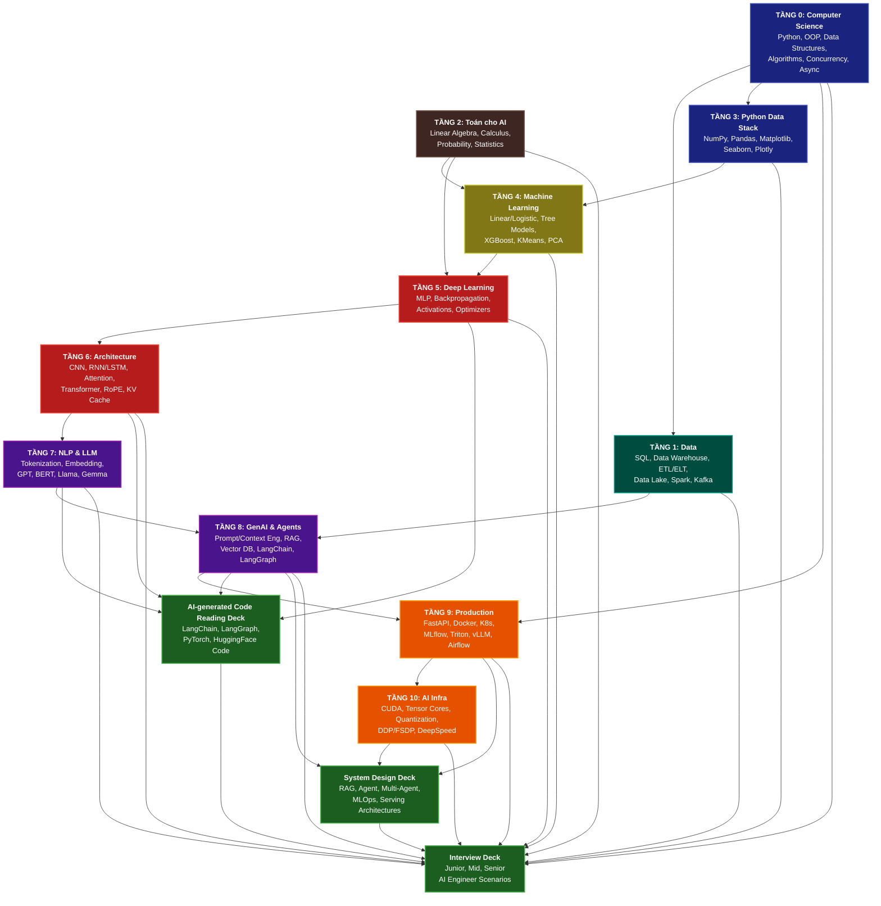

# AI Engineering Knowledge Graph

Sơ đồ dưới đây trực quan hóa mối quan hệ, các tầng phụ thuộc từ căn bản đến chuyên sâu của Lộ trình AI Engineering (Tầng 0 đến Tầng 10) kết hợp cùng 3 bộ deck chuyên sâu: **AI-generated Code Reading**, **System Design**, và **Interview Preparation**.

---

## 1. Bản Đồ Mối Quan Hệ (Knowledge Graph)

---

## 2. Chi Tiết Lộ Trình Tri Thức (Knowledge Paths)

Lộ trình được thiết kế nhằm đưa một kỹ sư đi từ nền tảng máy tính cơ bản nhất đến mức làm chủ toàn bộ hạ tầng và kiến trúc hệ thống AI hiện đại.

### Con Đường 1: Foundation & Data Flow (Nền Tảng & Luồng Dữ Liệu)
- **Computer Science (Tầng 0)** cung cấp nền tảng tư duy lập trình cấu trúc dữ liệu, thuật toán và bất đồng bộ (Async/Concurrency). Đây là điều kiện tiên quyết để làm việc với dữ liệu quy mô lớn ở **Data (Tầng 1)** và thao tác mảng tính toán hiệu năng ở **Python Data Stack (Tầng 3)**.
- Dữ liệu thô từ **Tầng 1** đi qua **ETL/ELT** sẽ làm đầu vào cho các mô hình học máy **Tầng 4**.

### Con Đường 2: Mathematics to Deep Learning (Toán học tới Học Sâu)
- **Toán cho AI (Tầng 2)** gồm Đại số tuyến tính, Giải tích và Xác suất thống kê tạo thành "xương sống" cho **Machine Learning (Tầng 4)** và **Deep Learning (Tầng 5)**. Không có toán học, việc tối ưu hóa trọng số (Gradient Descent, Backpropagation) ở Tầng 5 chỉ là lập trình vẹt.
- Từ **Deep Learning (Tầng 5)**, người học tiếp tục đi sâu vào các cấu trúc nâng cao tại **Architecture (Tầng 6)** (đặc biệt là cơ chế Attention và Transformer) để làm bước đệm cho **NLP & LLM (Tầng 7)**.

### Con Đường 3: GenAI & Productization (GenAI và Đưa vào Sản Phẩm)
- **NLP & LLM (Tầng 7)** dẫn lối trực tiếp đến kỷ nguyên **GenAI & Agents (Tầng 8)**, nơi lập trình viên tương tác với LLM thông qua Prompt, Context, Tool Calling và xây dựng các hệ thống Agentic (LangChain, LangGraph).
- Các ứng dụng GenAI cần được đưa lên môi trường thực tế thông qua **Production (Tầng 9)** nhờ containerization (Docker, Kubernetes) và tối ưu phục vụ (vLLM, Triton).
- Cuối cùng, để vận hành ở quy mô siêu lớn với chi phí tối ưu, **AI Infra (Tầng 10)** huấn luyện phân tán (DDP, DeepSpeed) và tối ưu hóa phần cứng (CUDA, Quantization) là nấc thang cao nhất của AI Engineer.

---

## 3. Vai Trò Của 3 Advanced Decks

3 Deck chuyên sâu được đề xuất đóng vai trò **cầu nối thực tế** chuyển hóa lý thuyết thành năng lực làm việc chuyên nghiệp:

1. **AI-generated Code Reading Deck**:
   - *Mục tiêu*: Khắc phục điểm yếu "hiểu lý thuyết nhưng không đọc được code thực tế". 
   - *Phạm vi*: Đọc và phân tích các mẫu code thực tế trong PyTorch (Custom training loops, Autograd hooks), HuggingFace (PEFT, Tokenizers), LangChain (LCEL chains), và LangGraph (State management).
   
2. **System Design Deck**:
   - *Mục tiêu*: Nâng tầm tư duy từ lập trình viên đơn thuần lên kiến trúc sư hệ thống AI.
   - *Phạm vi*: Thiết kế hệ thống RAG nâng cao (Reranking, Query Translation), Agentic workflow, Multi-Agent orchestration, hạ tầng MLOps (Experiment tracking, Feature Store) và các mô hình Serving có độ trễ cực thấp.

3. **Interview Deck**:
   - *Mục tiêu*: Hệ thống hóa toàn bộ kiến thức để sẵn sàng cho các vòng tuyển dụng kỹ thuật khắt khe.
   - *Phạm vi*: Các tình huống phỏng vấn thực tế từ mức Junior (thuật toán cơ bản, so sánh mô hình), Mid (xử lý dữ liệu, tinh chỉnh mô hình) đến Senior (thiết kế hạ tầng, phân tích trade-off và tối ưu hóa CUDA).
